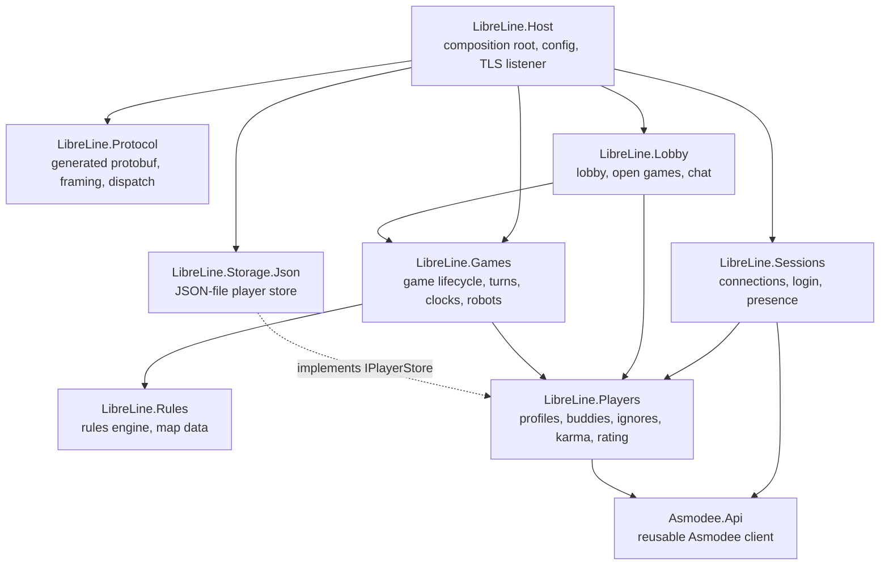
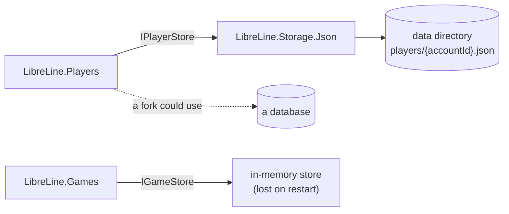

# Server architecture

A single process (a modular monolith) in C# on .NET 10. Each domain is its own assembly with a small public
interface; everything else in it is `internal`. Domains talk to each other only through those interfaces. Storage
sits behind interfaces too, so a fork can swap the shipped implementations for a database without touching the rest.

Assemblies are named `LibreLine.*`, the configuration section is `LibreLine`, and the Docker image is `libreline`.

## Assemblies



| Assembly | Owns | Public surface |
|---|---|---|
| `Asmodee.Api` | HTTP calls to `api.asmodee.net`: token check, profiles, buddy lists ([asmodee.md](protocol/asmodee.md)) | `IAsmodeeClient` and its records; `AddAsmodeeApi()` |
| `LibreLine.Protocol` | classes generated from [`proto/`](../proto), length-prefixed framing, `Packet` envelope, routing messages by extension number | `PacketReader`/`PacketWriter`, `IMessageHandler<T>`, a dispatcher |
| `LibreLine.Sessions` | the TLS connections, login (`AsyncAuth` → Asmodee → `AsyncConnected`), heartbeats, the online registry, presence | `ISessionRegistry` (who is online, send to a player), `IPresence` |
| `LibreLine.Players` | player records: name, SteamID, cached entitlements, karma, rating, buddies (filled from Asmodee on first login), ignores; turning entitlements into `Player.rights` | `IPlayerService`, `IPlayerStore` (storage contract), `IKarmaPolicy`, `IRatingPolicy` |
| `LibreLine.Lobby` | lobby player and game lists, open games and joining, invitations, lobby and game chat, observers | message handlers only; uses `IGameService` |
| `LibreLine.Games` | game creation, opening round, commits and relaying, status reports, clocks, robots, withdrawals, time-outs, results; an in-memory game store | `IGameService`, `IGameStore` (storage contract) |
| `LibreLine.Rules` | the [rules engine](RULES.md) and the [map data](maps/README.md); no I/O | `IRulesEngine`, `IMapCatalog` |
| `LibreLine.Storage.Json` | `IPlayerStore` as JSON files in the data directory | `AddJsonPlayerStore()` |
| `LibreLine.Host` | `Program.cs`, configuration, logging, the listener, wiring every module | the executable |

### Rules for dependencies

- **Asmodee.Api knows nothing about this game.** It only wraps the HTTP API, so it can be reused for other Asmodee
  games. Turning features into this game's product codes lives in `LibreLine.Players`.
- **LibreLine.Rules depends on nothing but the BCL.** It can be tested on its own and used by tools.
- **Domains don't reference storage implementations.** They define the store interfaces, other assemblies
  implement them, and only the host chooses which implementation is used.
- **Protobuf types stay at the edges.** The protocol handlers in Sessions, Lobby and Games translate them to the
  domain's own types. The opaque game payloads (`T2RCommit` and the others) are kept as bytes.
- **Each module registers itself** with an `IServiceCollection` extension (`AddGames()`, ...). The host calls them.

### Map data

The map documents in [docs/maps](maps/README.md) are the server's map data. `LibreLine.Rules` embeds those Markdown
files as resources and parses their tables at start-up, so there's one source of truth and no generated data file.
A test checks that every map file parses, and that the ids run without gaps.

## Storage



- **Players:** one JSON file per player under the configured data directory. Each file holds:
  - the account id and name;
  - the SteamID and the entitlements cached at the last login;
  - karma, rating and games played;
  - buddies and ignores.

  Writes go to a temporary file that is then renamed into place, so a crash never leaves half a file.
- **Games:** kept in memory only, and lost on restart (see [DESIGN.md](DESIGN.md#what-the-server-keeps)). They still
  sit behind `IGameStore`, so a fork can persist them without changing the Games domain.
- **Swapping storage.** The interfaces work per record (get, save, list), so a database implementation can replace
  the shipped one in a fork without changing the domains.

## Configuration

Standard .NET configuration: `appsettings.json`, then environment variables (`LibreLine__DataDirectory`, ...), then
command line.

```json
{
  "LibreLine": {
    "Port": 2445,
    "DataDirectory": "data",
    "Certificate": { "Path": "", "Password": "" },
    "Asmodee": { "BaseUrl": "https://api.asmodee.net/" },
    "Maps": "0-16",
    "Rules": "enforce"
  }
}
```

| Setting | Meaning |
|---|---|
| `Port` | the TLS port the client connects to (the client's default is 2445) |
| `DataDirectory` | where the player files go |
| `Certificate.Path` | a PFX file. If empty, a self-signed certificate is created in the data directory on first run; the client doesn't check it. |
| `Asmodee.BaseUrl` | Asmodee's API |
| `Maps` | which map enums games may be created on (the maps the rules engine supports). This doesn't check entitlements. |
| `Rules` | `enforce` (refuse illegal moves), `audit` (log them only) or `off` |

## Docker

A multi-stage `Dockerfile` at the repository root:

1. **Build stage** `mcr.microsoft.com/dotnet/sdk:10.0`: restore, run the tests, publish `LibreLine.Host`.
2. **Runtime stage** `mcr.microsoft.com/dotnet/runtime:10.0`: run as a non-root user.
   - The data directory is a volume at `/data`.
   - The port is 2445.

There is no published image; people build their own:

```bash
docker build -t libreline .
```

```bash
docker run -d --name libreline -p 2445:2445 -v libreline-data:/data libreline
```

A `docker-compose.yml` with the same settings goes beside the `Dockerfile`. A GitHub Actions workflow builds and
tests on every push (including the Docker build).

## Testing

- **Unit tests for observed behaviour.** Each assembly is unit-tested against the behaviour documented in these docs.
  - *Rules:* each rule in [RULES.md](RULES.md) and the map files gets small hand-written cases, for example:
    - a deal from a given seed;
    - a tunnel reveal and its extra cost;
    - a ticket with several destinations;
    - each bonus.
  - *Protocol:* each sequence in the [protocol docs](protocol/README.md) gets a short scripted exchange, run against
    the host over a real TLS socket.
- **No game captures.** Recorded games aren't used as test data and aren't kept in the repository.
- **Real-client checks.** Rule changes are only verified once the real client has played the map against the server
  and its final scores match.
