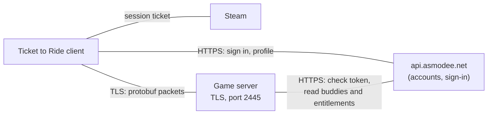
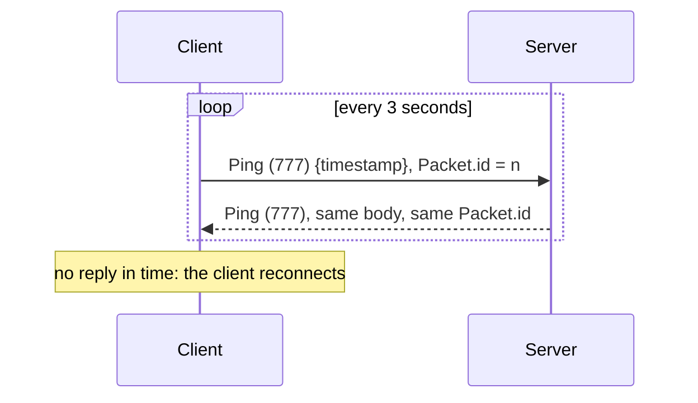

# Protocol overview

How the Ticket to Ride client (Steam, version 2.7.12) talks to its online game server. Everything here was observed
with the real, unmodified client.

| Page | Covers |
|---|---|
| [This page](README.md) | connection, framing, the message envelope, heartbeats, the message catalogue |
| [login.md](login.md) | Asmodee sign-in, the game-server login, what the client does next, reconnecting |
| [social.md](social.md) | lobby, player and game lists, presence, buddies and ignores, chat, invitations, open games, observing |
| [game.md](game.md) | a game from creation to results: turns, moves per map, robots, clocks, withdrawing, time-outs |
| [asmodee.md](asmodee.md) | the Asmodee API calls the server makes: token check, entitlements, buddies |

The message definitions are the `.proto` files in [`proto/`](../../proto). Messages are referred to by name and
extension number, e.g. `AsyncAuth` (400); the proto names add a `Request` suffix (`AsyncAuthRequest`).

## The services involved



- **Asmodee** runs player accounts. The client signs in there itself (with its Steam ticket) and gets an OAuth access
  token. Its address is built into the client and can't be changed.
- **The game server** does everything online play needs: lobby, presence, buddies, chat, invitations, storing and
  relaying games, clocks and results. It is the only part that has to be replaced.
- The game rules run in the clients. The server relays moves without needing to understand them. To check moves and
  score games it keeps its own model ([RULES.md](../RULES.md)).

## Pointing the client at a server

The client takes its game-server address from its settings file,
`%LOCALAPPDATA%\Days of Wonder\Ticket to Ride\UserDefault.xml`. Close the game, then add this inside
`<userDefaultRoot>`:

```xml
<customAsyncServerName>ttr.example.org:2445</customAsyncServerName>
```

The port is optional (default 2445). Use `customAsyncServerName`, not `asyncServerName`: with the latter the client
still checks the official server's certificate pins and refuses any other server. With `customAsyncServerName` it
accepts any certificate, self-signed included.

The connection is TLS, versions 1.0 to 1.2 (the client's OpenSSL predates 1.3), with a cipher such as
`ECDHE-RSA-AES128-GCM-SHA256`.

## Framing

Each message is a 4-byte big-endian length followed by that many bytes of a protobuf `com.daysofwonder.async.Packet`.
There is no other header, compression or encryption beyond TLS.

```text
+------------------------+------------------------------------+
| uint32 length, BE      | Packet (protobuf), `length` bytes  |
+------------------------+------------------------------------+
```

## The envelope

```proto
message Packet  { optional int64 id = 1; optional com.daysofwonder.mm.Message payload = 3; }
message Message { optional int32 request_number = 1; optional int32 id = 2; extensions 100 to max; }
```

- **One message per packet.** Exactly one extension of `Message` is set, and its field number is the message type
  (the catalogue below). `request_number` repeats that number; the server should set it too.
- **`Packet.id` matches replies to requests.** The client numbers its requests, and **a reply must carry the same
  `Packet.id` as its request**. Messages the server sends on its own (pushes) use `id = 0`.
- **Reply-only messages must not be pushed.** A message the client treats as a reply, e.g. `GameStatusReport`
  (512), is rejected if it arrives unasked.
- **Errors.** `Error` (505, an `ErrorCode` and text) may be sent in place of any reply.
- **Waiting for a reply.** The client waits about 30 seconds, then gives up ("Client timeout"). While it waits for
  one reply, later requests can queue behind it, so every request that has a reply must get one.

**Compressed lists.** Some fields hold a serialized message that has been zlib-compressed:

- `LobbyPlayerList.player_list`;
- `LobbyGameList.game_list` and `ObservableGameList.game_list`.

Uncompressed bytes make the client drop the message.

**Player ids are seat numbers.** Wherever the client receives a list of `Player`s, `Player.id` is the player's
1-based position in that list: the buddy list, a game's players, and so on. The client files each entry at `id − 1`,
and an id out of range makes it drop the whole message or crash. The same goes for the player and slot fields of
game messages (`local_player_id`, `invited_by`, `player_id`, `recipient_ids`, presence lists inside a game). The
account id is `Player.w_w_w_id`.

## Heartbeat



Pings have their own `Packet.id` counter (1, 2, 3, ...), separate from requests, so ids aren't unique on a
connection. Echoing the ping back unchanged is enough.

## Message catalogue

"C→S" is from client to server, "S→C" the other way. "Push" means the server sends it on its own, with `Packet.id`
0.

### Connection

| # | Message | Direction | Reply / notes |
|---:|---|---|---|
| 400 | AsyncAuth | C→S | → 406 or 407 |
| 401 | AsyncDisconnect | C→S | none; the client is going away (also sent when the window is minimised) |
| 406 | AsyncConnected | S→C | session id and the player's own record |
| 407 | AsyncConnectionError | S→C | login refused, with a `ConnectionError` code |
| 408 | AskServerStatistics | C→S | → 409 ServerStatistics `{hosted_games, players, connected_players}` |
| 412 | AsyncUnlinkDevice | C→S | → 413 AsyncDeviceUnlinked |
| 505 | Error | S→C | in place of any reply |
| 777 | Ping | both | echoed |

### Lobby, presence and social

| # | Message | Direction | Reply / notes |
|---:|---|---|---|
| 600 | EnterLobby | C→S | → 601 LobbyEntered |
| 602 | ExitLobby | C→S | → 603 LobbyExited |
| 604 | LobbyPlayerList | S→C push | everyone online; resent whole on every change |
| 605 | AskPlayerInfo | C→S | → 606 LobbyPlayerInfo |
| 630 | AskAnyPlayerInfo | C→S | → 631 PlayerInfo |
| 515 | AsyncBuddyList | C→S | → 516 AsyncBuddyListContent |
| 518 | AsyncBuddyManagement | C→S | → 519 AsyncBuddyAdded / 520 AsyncBuddyRemoved |
| 560 | AsyncIgnoreList | C→S | → 561 AsyncIgnoreListContent |
| 562 | AsyncIgnoreManagement | C→S | → 563 AsyncIgnoreAdded / 564 AsyncIgnoreRemoved |
| 527 | RegisterPresence | C→S | → 517 AsyncBuddyPresencePartialUpdate |
| 528 | UnregisterPresence | C→S | none |
| 517 | AsyncBuddyPresencePartialUpdate | S→C | also pushed when a registered player connects or drops |
| 532 | SubscribePresenceService | C→S | none; the server pushes 506 |
| 533 | UnsubscribePresenceService | C→S | none |
| 506 | PlayerPresenceUpdate | S→C push | who is present in a game |
| 524 | MulticastChat | C→S | relayed as 525 ClientChat (or 526 ClientChatBlocked) |
| 535 | GetChatHistory | C→S | → 536 ClientChatHistory |

### Creating and joining games

| # | Message | Direction | Reply / notes |
|---:|---|---|---|
| 405 | EngageGameWithFriends | C→S | → 404 GameCreated |
| 404 | GameCreated | S→C | reply to 405, or pushed to invitees and to lobby players when a game fills |
| 540 | AnswerInvitation | C→S | → 541 InvitationAnswered (also pushed to the other players) |
| 607 | LobbyCreateGame | C→S | → 608 LobbyGameCreated |
| 609 | LobbyGameList | S→C push | the open games; resent whole on every change |
| 610 | LobbyJoinGame | C→S | → 611 LobbyNewPlayer, or 612 LobbyJoinDenied |
| 613 | LobbyLeaveGame | C→S | → 614 LobbyPlayerLeftGame |
| 402 | EngageGame | C→S | automatch without a lobby → 403 GameEngaged; not seen from this client |
| 410 | DisengageGame | C→S | → 411 GameDisengaged; not seen from this client |

### Playing

| # | Message | Direction | Reply / notes |
|---:|---|---|---|
| 511 | WhatsNewPussycat | C→S | → 512 GameStatusReport (reply only) |
| 534 | SwitchedToGame | C→S | none; which game the client is viewing (none = left it) |
| 565 | UserDataUpdateRequired | S→C | |
| 566 | UpdateUserData | C→S | → 567 UserDataUpdated |
| 500 | ActionRequired | S→C push | your move |
| 501 | CommitAction | C→S | → 523 ActionCommited |
| 502 | MulticastData | C→S | relayed to the recipients as 503 ClientData |
| 504 | PlayerTimeout | S→C push | a player ran out of time, or a robot's turn |
| 537 | PlayerReplaced | S→C push | a seat became, or stopped being, a robot |
| 538 | LeaveSyncGame | C→S | none |
| 539 | ResumeSyncGame | C→S | none |
| 546 | GetClocks | C→S | → 547 ClocksStatus; polled every 15 seconds |
| 542 / 544 | PauseClock / ResumeClock | C→S | → 543 / 545; never seen sent |
| 507 | GameOver | C→S | final state and scores, from the client that made the last move |
| 508 | GameOutcome | S→C | results, to every player |
| 522 | GameOutcomeConfirmation | C→S | none; the player has seen the results |
| 513 | GameForfeit | C→S | → 514 GameForfeited (also pushed to the other players) |
| 529 | GameAbort | C→S | → 530 GameAborted → 531 GameAbortedConfirmation |

### Observing

| # | Message | Direction | Reply / notes |
|---:|---|---|---|
| 620 | SubscribeToObservableGameList | C→S | → 621 SubscribedToObservableGameList, then 622 pushes |
| 622 | ObservableGameList | S→C push | |
| 650 | StartObserveGame | C→S | → 652 GameObserved |
| 651 | StopObserveGame | C→S | → 652 GameObserved (the client waits for it) |

Numbers 100-220 in `request.proto` belong to an older protocol that this client doesn't use.

## Key enums

- **`GameStatus`:** IN_PROGRESS 1, OVER 2, NOT_STARTED 3, ABORTED 4, OUTCOME 5, PLAYER_TIMEOUT 6, ABORTING 7,
  WAITING_INVITATION 8, FIRST_USER_DATA_ROUND 9.
- **`ErrorCode`:**

  | Code | Name | Code | Name |
  |---:|---|---:|---|
  | 1 | NOT_YOUR_TURN | 10 | PLAYER_ALREADY_IN_LOBBY |
  | 2 | UNKNOWN_PLAYER | 11 | NOT_YOUR_INVITATION |
  | 3 | UNKNOWN_GAME | 12 | CURRENT_PLAYER_IS_BOT |
  | 4 | MAINTENANCE_MODE | 13 | INVITATION_DENIED |
  | 5 | TOO_MANY_OFFERS | 14 | BAD_REQUEST |
  | 6 | UNKNOWN_DEVICE_TOKEN | 15 | WRONG_STATE |
  | 7 | YOU_FORFEITED | 16 | DUPLICATE_SESSION |
  | 8 | YOU_RAN_OUT_OF_TIME | 17 | PLAYER_NOT_IN_LOBBY |
  | 9 | YOU_LEFT | | |

- **`ConnectionError`:** UNKNOWN 0, ACCESS_DENIED 1, SERVERFULL_ERROR 2, MAINTENANCE_MODE 3, NEED_AUTHENTICATION 4,
  UNKNOWN_GAME_TYPE 5, SERVER_ERROR 6, BANNED 7.
- **`GameMode`:** SYNCHRONOUS 1 (a live game; absent players are replaced by robots), ASYNCHRONOUS 2 (players can
  come and go).

## Game payloads

Game data travels in `bytes` fields that the server stores and forwards. They hold Ticket to Ride messages from
`ticketToRide.proto` (package `pb`):

| Field | Holds |
|---|---|
| `CommitAction.next_state`, `ActionRequired.state`, `StatusReport.data` | `pb.T2RCommit`: the settings and the whole move history |
| `CommitAction.next_summary_data`, `StatusReport.summary_data` | `pb.T2RSummary`: what the game list shows |
| `MulticastData.data`, `ClientData.data` | `pb.T2RMulticast`: one move |
| `UpdateUserData.user_data`, `PlayerPregameData.data` | `pb.T2RPlayerState`: a player's private opening choice |
| `GameConfiguration.data` | game options; field 13 is `pb.Settings` (seed, map, players, first player, rules engine version) |

The message in `GameConfiguration.data` isn't among the recovered protos. Only field 13 is understood.

To relay a game the server doesn't need to read any of them. To check moves it does
([game.md](game.md#checking-moves)).
