# Playing a game

The clients run the game. The server stores each game's state, says whose move it is, relays moves between players,
runs the clocks and records the result. The rules it checks moves against are in [RULES.md](../RULES.md).

## Life of a game

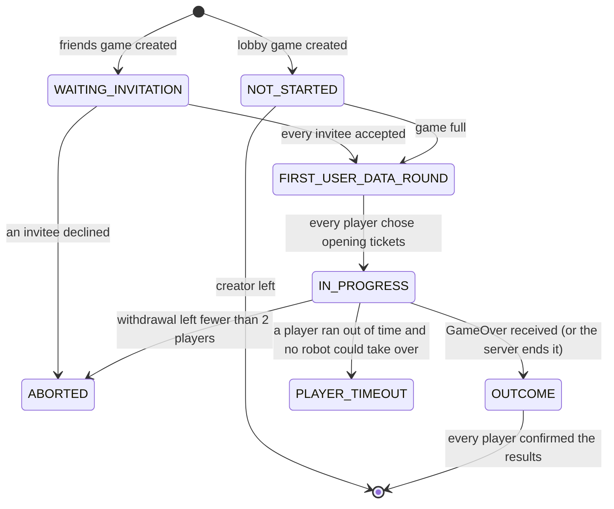

The state names are `GameStatus` values. The client gets them in `StatusReport.status`.

## Status reports

`WhatsNewPussycat` (511) asks for the player's games, and `GameStatusReport` (512) answers with a `StatusReport` per
game. Without a `game_id`, the request covers every game; with `summary_data_only: false` and a `game_id`, the
report carries the full state. The client sends it after login, after a game is created (to fill the Resume tab),
and whenever it opens a game. It is reply-only: never push it.

| `StatusReport` field | Meaning |
|---|---|
| `status` | `GameStatus` |
| `data` | the latest `pb.T2RCommit` (the whole move history) |
| `summary_data` | the latest `pb.T2RSummary` |
| `players` | the seats, `Player.id` = seat, `is_bot` for robots |
| `turn_id` | the seat to move (1-based) |
| `active_player` | the seat of the human whose client plays this turn: the same as `turn_id`, or for a robot its controller |
| `next_player_ids` | the turn queue from the last commit |
| `turn_index` | number of commits so far |
| `clock` | each seat's `GameClock` |
| `user_data`, `player_user_data_updated` | opening choices; send only until the first commit (see below) |
| `forfeiters`, `timed_out_players`, `left_players` | seats that withdrew, ran out of time, or left a single-session game |
| `invitation` | for a pending invitation: `invited_by` |
| `outcome_not_seen` | seats that haven't confirmed the results yet |
| `configuration` | the game's `GameConfiguration` |

The Resume tab hides games where the player is listed in `forfeiters` or `timed_out_players`, and games whose
results they have confirmed.

## Creating a game

The requests are described in [social.md](social.md#invitations-friends-games) (friends games) and
[social.md](social.md#open-games-and-automatch-lobby-games) (lobby games). The server's side:

- **Check the settings first.** Read `pb.Settings` from field 13 of `configuration.data` (see
  [Game payloads](README.md#game-payloads)).
  - Refuse with `Error` (505) `{BAD_REQUEST, msg}` if the map isn't one the server hosts, or if `rulesEngineVersion`
    isn't that map's version ([maps/](../maps/README.md)). Refuse before creating anything.
  - The client shows "Bad request" and recovers.
- **Game id:** any unique positive `int64`. Games are lost on restart, so pick ids that don't repeat across
  restarts, for example from the clock. A client may still list an old id.
- **Seats:** `Player.id` 1 is the creator. Friends follow in the order of `EngageGameWithFriends.friends`, and lobby
  joiners in the order they joined. Each `Player` carries `w_w_w_id`, `name`, `karma`, `rank_score` and
  `is_active: true`.
- **`GameDetails`:** `{game_id, configuration, players, user_data}`. The `user_data` part holds the creator's
  `EngageGameWithFriends.user_data` as seat 1's `PlayerPregameData`, if it isn't empty.
- **The stored game starts with:**
  - an empty state;
  - `initial_summary_data`, or failing that `initial_state` (a `T2RSummary`), as its summary;
  - status `WAITING_INVITATION` (friends game) or `NOT_STARTED` (lobby game).

## Opening: choosing tickets

Games start with the "first user data round" (when `configuration.require_first_user_data_round` is set, as the
client always does). Every player privately picks their opening tickets at the same time.

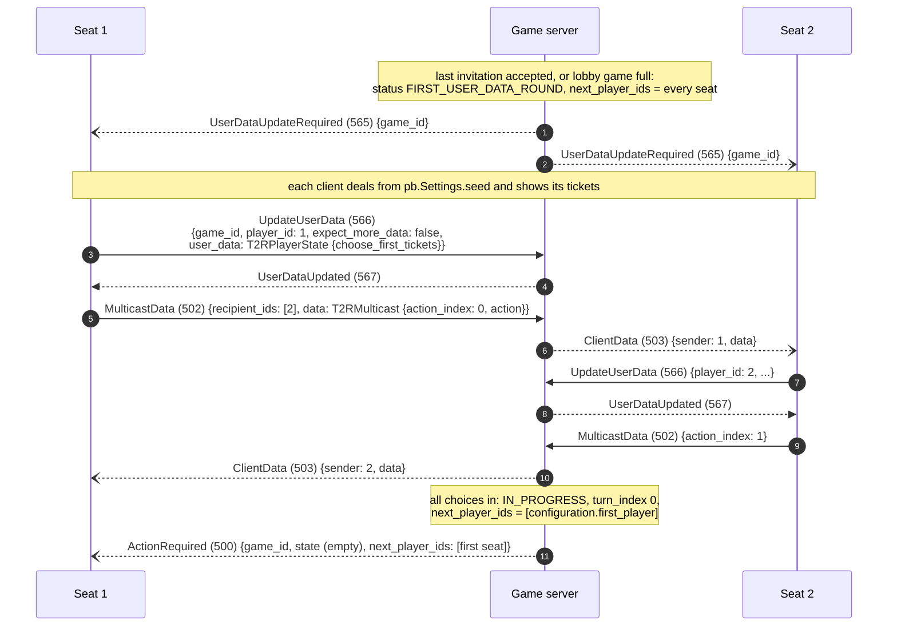

- **Tracking the round.**
  - `UserDataUpdated` (567) echoes `{game_id, player_id, user_data}` back to the sender.
  - An update with `expect_more_data: false` takes that seat out of `next_player_ids`. When the list is empty, the
    game moves to `IN_PROGRESS`.
  - A robot seat's choice comes from its controller's client (see [Robots](#robots)).
- **The first seat to move** is `configuration.first_player`, a 1-based seat. (`pb.Settings.first_player` is the
  same seat counted from 0.)
- **Checking the choice.** With the rules model, a choice that isn't legal gets `Error` (505) `{WRONG_STATE}`. For
  example, too few tickets kept, or tickets that weren't dealt to that seat.
- **Keep each player's `user_data` private.** It holds their hidden tickets, so send it only to its owner.
- **Honour `UpdateUserData.player_id`.** A client running a robot sends the robot's choice under the robot's seat.
- **Send the choices in reports only until the first commit.** After that the committed state carries them. A report
  with both makes the client count the opening choices twice and lose sync.
- **The first `ActionRequired` may have an empty `state`.** The client builds the position from the settings.
- **A possible race:** the server may tell the first player to move before every opening multicast has reached them.
  The server can guard against it by refusing a commit whose state lacks an opening choice the server already holds.

**Germany.** Players first say how many short and long tickets they want, then choose:

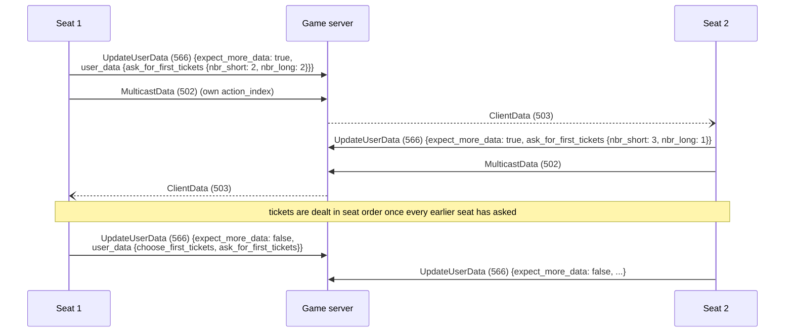

## A turn

Every action in a turn is committed separately. The player's client multicasts each action to the others, and
commits the new state with a turn queue saying who acts next.

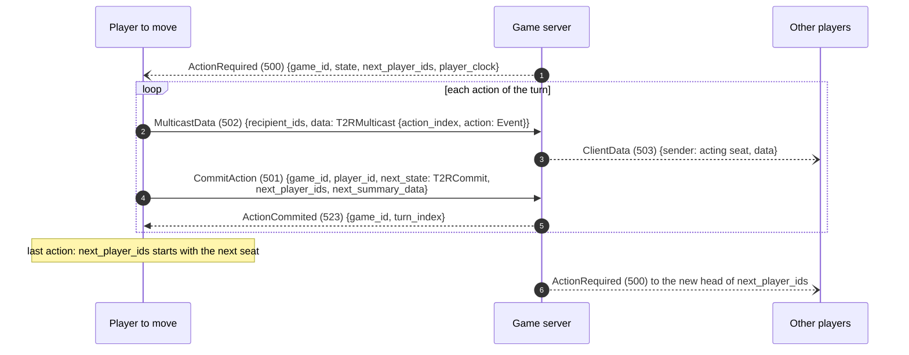

**`ActionRequired` (500)** goes to the client of the seat at the head of the queue:

| Field | Value |
|---|---|
| `game_id`, `turn_index` | the game, and the number of commits so far |
| `state` | the latest `T2RCommit` (empty before the first commit) |
| `players` | the seats |
| `next_player_ids` | the turn queue |
| `different_player` | true when the recipient is acting for a seat other than its own (a robot it controls) |
| `user_data` | before the first commit only: the opening choices of the seat to move and of the recipient's own seat |
| `player_clock` | the clock of the seat to move |

The client refuses an `ActionRequired` whose state is non-empty and whose turn isn't its own seat's. Never send one
for another seat to a game screen, except to drive a robot (see [Robots](#robots)).

Send `ActionRequired` again when the player at the head of the queue comes back to the game: their client sends
`SwitchedToGame` (534) with the game's id. Any `ActionRequired` sent while they were away may have been lost.

- **`next_player_ids` is a queue.** Only its head may act. After a player's first card it is `[1, 2]` (seat 1 still
  acting); after the turn ends it is `[2, 1]`.
- **`action_index`** is a move's place in the history: the number of opening choices (one per player) plus the
  number of earlier actions. Each action takes the next number, with no gap between turns. The other clients use it
  to order and de-duplicate moves. If it's ahead of what they expect, they reload the whole state ("out of sync").
- **`ClientData.sender`** must be the acting seat (`T2RMulticast.action.player`), not the connection's player.
- **Moves reach the game screen only through `ClientData`.** The game screen ignores the states in
  `ActionRequired`; a client that is away catches up from its status report instead.

### Moves by map

`pb.Event` types, with the turn shape each makes. "Open" means the turn continues after that commit (the same seat is
still at the head of `next_player_ids`).

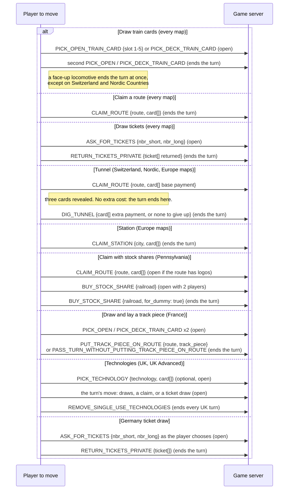

Each arrow is a `MulticastData` plus a `CommitAction`, as in the turn above.

| Event type | # | Fields used |
|---|---:|---|
| CLAIM_ROUTE | 1 | `player`, `route`, `card[]` |
| CLAIM_STATION | 2 | `player`, `city`, `card[]` |
| ASK_FOR_TICKETS | 3 | `player`, `nbr_short`, `nbr_long` |
| PICK_OPEN_TRAIN_CARD | 4 | `player`, `slot` (1-5) |
| PICK_DECK_TRAIN_CARD | 5 | `player` |
| RETURN_TICKETS_PRIVATE | 7 | `player`, `ticket[]` (the tickets given back) |
| DIG_TUNNEL | 14 | `player`, `card[]` (empty = give up) |
| CHOOSE_FIRST_TICKETS_PRIVATE | 15 | `player`, `ticket[]` (the tickets kept) |
| BUY_STOCK_SHARE | 16 | `player`, `railroad`, `for_dummy` |
| ASK_FOR_FIRST_TICKETS | 17 | `player`, `nbr_short`, `nbr_long` |
| PICK_TECHNOLOGY | 18 | `player`, `technology`, `card[]` |
| REMOVE_SINGLE_USE_TECHNOLOGIES | 19 | `player` |
| PUT_TRACK_PIECE_ON_ROUTE | 20 | `player`, `route`, `track_piece` |
| PASS_TURN_WITHOUT_PUTTING_TRACK_PIECE_ON_ROUTE | 21 | `player` (not seen) |

The other types (6, 8-13, 22) were never seen in a game.

## Checking moves

The server reads the committed state, `pb.T2RCommit`:

| Field | Holds |
|---|---|
| `settings` | `pb.Settings`: seed, map, number of players, first player, rules engine version |
| `action` | every move so far, in order, as `pb.Event`s (the opening choices are not in it) |
| `player_state` | each seat's opening choice: `{player_id, choose_first_tickets, ask_for_first_tickets}` |
| `game_over` | set in the final state sent with `GameOver` |
| `hash`, `next_player` | left unset or unused by the client |

`pb.T2RMulticast` (a relayed move) is `{action_index, player, action: pb.Event}`.

A commit is accepted only when all of these hold. The first failure decides the reply:

| Check | Refused with |
|---|---|
| the seat ran out of time | `Error` (505) `{YOU_RAN_OUT_OF_TIME}` |
| the sender plays `player_id` (their own seat, or a robot they control) | `{NOT_YOUR_TURN}` |
| the new `action` list starts with the stored one and only adds actions by `player_id` | `{NOT_YOUR_TURN}` |
| `player_id` is at the head of the stored queue (see below) | `{NOT_YOUR_TURN}` |
| the new actions are legal in the rules model (when rules are enforced) | `{WRONG_STATE}` |

`Error` carries `game_id`, `turn_index` and `player_id`. On success the server:

1. stores the state and summary;
2. adds 1 to `turn_index`;
3. stores the new queue;
4. replies `ActionCommited` (523) `{game_id, turn_index}`;
5. sends the next `ActionRequired`.

**The queue head, with robots.** Robot commits can carry a stale queue: a robot's engine has committed a face-up
locomotive with the robot still at the head. So if the head is a robot whose seat made the last action, the next
seat in the queue may commit too. Don't trust `next_player_ids` from a robot's commit; work out the turn from the
history.

## End of the game

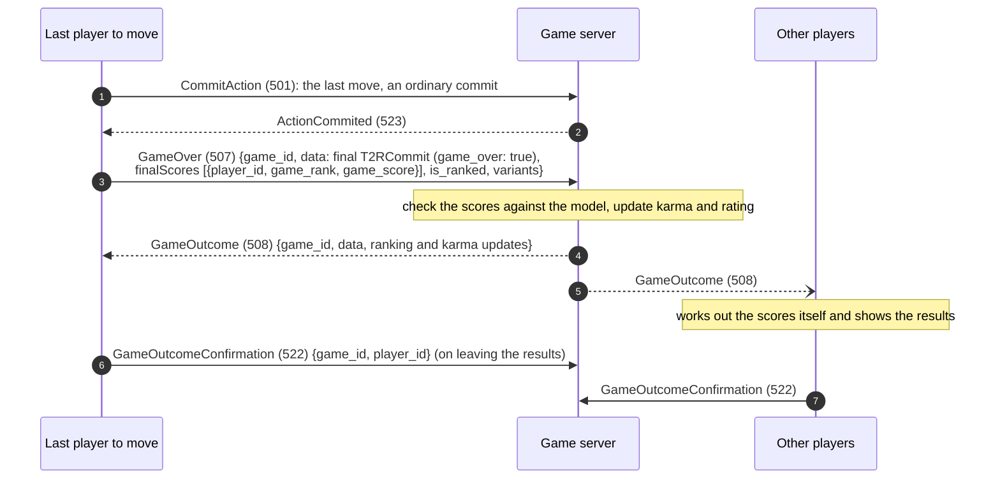

- **Only the client that made the last move reports scores.** For everyone else the server relies on its own model.
- **`variants`** ends with the map's short name, e.g. `["", "", "", "", "2p", "us"]`.
- **Status.** The game's status becomes `OUTCOME`. It leaves a player's list once they have confirmed;
  `outcome_not_seen` lists those who haven't.
- **Rating and karma** change only for lobby games ([social.md](social.md#open-games-and-automatch-lobby-games)). Every
  player starts at karma 50 and rating 1500.
  - *Karma:* +1 for a finished game (up to 100), −5 for withdrawing or running out of time.
  - *Rating:* multiplayer Elo over the final places, with K = 32. Players who withdrew or timed out count as last.
  - These figures come from an old player guide and a guess, and haven't been checked with the client.

## Clocks

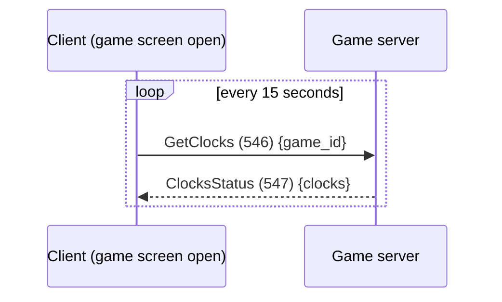

`ClocksStatus` (547) holds `{game_id, clock[]}`, one `{player_id, clock: GameClock}` per seat. The same list goes in
`StatusReport.clock`, and the seat to move's clock in `ActionRequired.player_clock`. All times are in milliseconds:

| `GameClock` field | Value |
|---|---|
| `started_at` | when the game was created (Unix ms) |
| `last_started_at` | when this seat's clock last started running, or `started_at` if it isn't running |
| `duration` | the whole bank: `configuration.timeout` × 1000 |
| `remaining` | what is left of the bank, never below 0 |
| `armed` | true only for the seat to move |
| `paused` | false |
| `timestamp` | now (Unix ms) |

- **Chess clocks.** Each seat has a bank of `configuration.timeout` seconds that runs only while that seat is to
  move. It doesn't reset each turn. Robots' clocks don't run out.
- **Arm only the clock of the seat to move.** The client seems to use the armed clock to decide whose turn it is.
- **Answer every poll.** A missing reply stalls the game screen.
- **Pause and resume** (542, 544) exist but no screen sends them.

## Robots

A seat can be played by a robot. The robot runs in a human player's client (its "controller", usually the game's
creator), in a background engine the client calls hotswap. The server's job is to wake that engine at the right
times.

**When a seat becomes a robot.**

- *Who controls it:* the creator, or if the creator has left, withdrawn or timed out, any remaining human.
- *What changes:* the seat's `Player.is_bot` is set in every later `players` list, and it reports `active_player` =
  the controller's seat whenever it is to move.
- *How:* a seat becomes a robot through withdrawal, time-out or leaving a single-session game (sections below). A
  seat can also be a robot from the start, with `is_bot` set when the game is created.

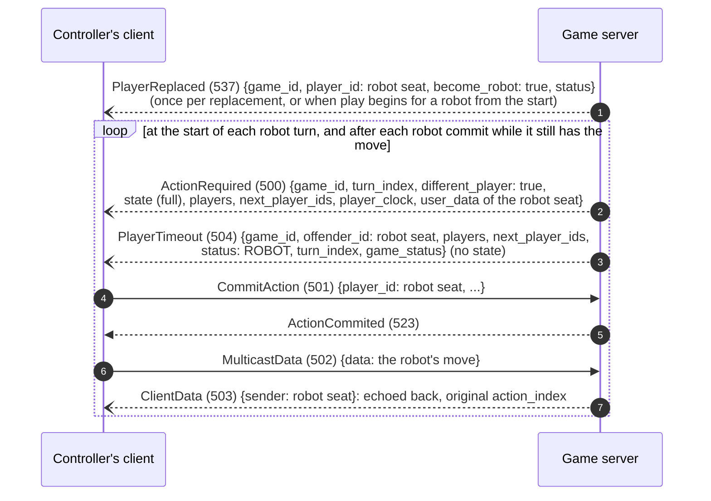

- **`ActionRequired` with the full state** reaches the robot engine. The controller's own game screen rejects it,
  because the turn isn't its seat's. A stateless `ActionRequired` would make the game screen start the human's turn
  instead.
- **`PlayerTimeout` wakes the engine.**
  - It needs `players`, and no `state`: with a mid-game state it crashes the client.
  - Send it on its own, never together with `PlayerReplaced`. A robot woken while the "replaced by a robot" dialog is
    open doesn't start.
- **`PlayerReplaced` is needed, once.** It assigns the seat to the robot; without it the engine never plays. Repeating
  it shows the dialog again.
- **One action per wake-up.** For a two-card draw, wake the engine again after its first commit.
- **The engine runs only while the controller's client is connected to the game.**
  - If the controller is offline when a robot turn starts, wait.
  - Repeat the `ActionRequired` when the controller sends `SwitchedToGame` (534) with no game (it left a game screen)
    while a robot it controls is to move.
  - Its own status reports also start the engine: `turn_id` = robot seat, `active_player` = the controller's seat.
- **The controller can play the robot's opening.** In `FIRST_USER_DATA_ROUND`, the client sends the choice for every
  robot seat whose `user_data` is still empty, as `UpdateUserData` with the robot's `player_id`.
- **Echo robot moves back to the controller with their original `action_index`.** Its game screen learns robot
  moves only from `ClientData`. Renumbering them causes duplicates.
- **The engine sends no `GameOver`** for a robot's last move. When a robot's commit ends the game in the rules
  model, the server ends it itself:
  1. sets `game_over`;
  2. works out scores and places from the model;
  3. sends `GameOutcome` to everyone.

## Withdrawing

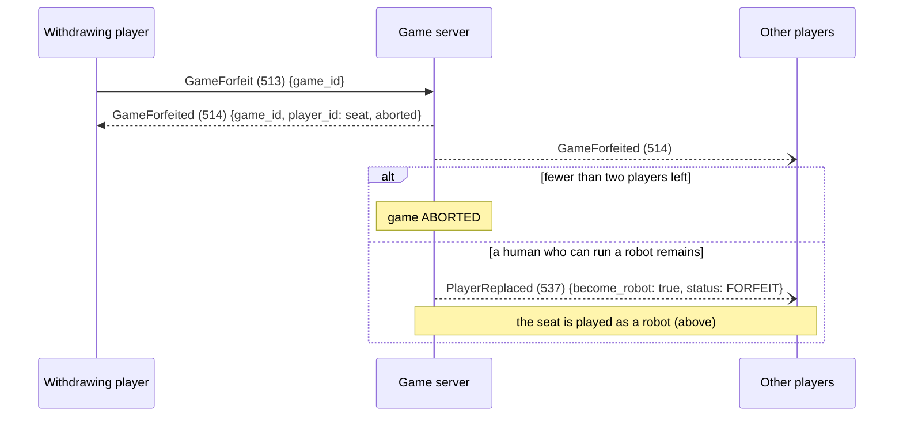

The seat goes into `StatusReport.forfeiters`, which hides the game from that player's Resume tab.

`GameAbort` (529) → `GameAborted` (530) → `GameAbortedConfirmation` (531) is the explicit abort; it wasn't seen from
this client.

## Running out of time

When the seat to move empties its time bank:

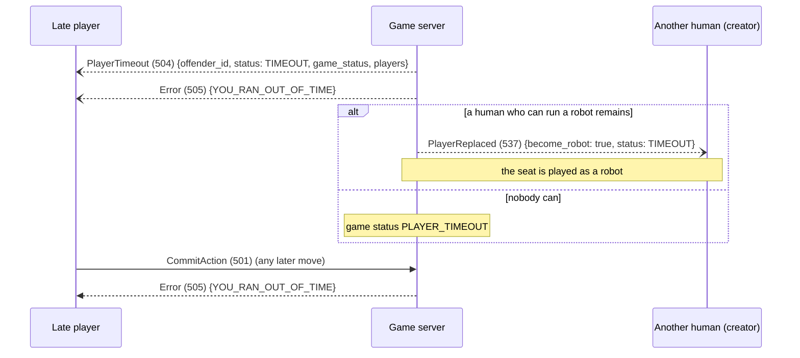

The client shows "out of time" and goes back to the menu, presenting it as a connection problem. The seat goes into
`timed_out_players`, which hides the game from that player's Resume tab.

## Leaving a single-session game

In `SYNCHRONOUS` games a player who leaves is replaced by a robot until they come back.

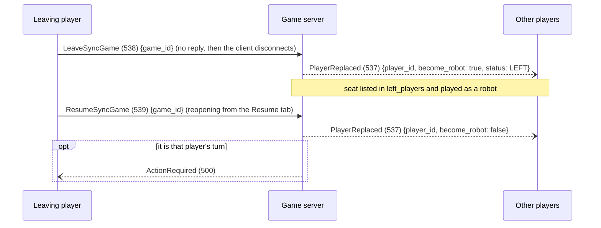

The robot's controller is the creator, or any remaining human if the creator left.
