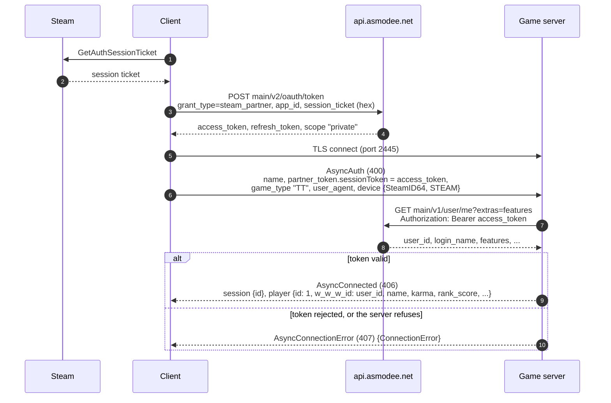
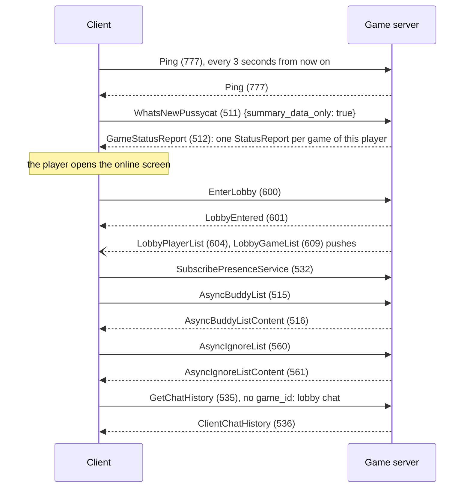
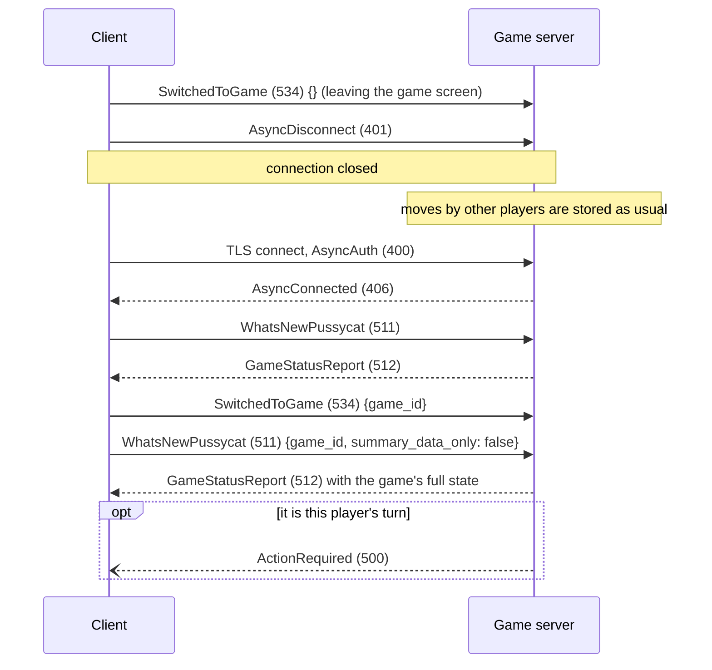

# Login

The player never types a password into the game server. The client signs in to Asmodee with its Steam ticket and
hands the game server the resulting Asmodee access token. The server checks the token with Asmodee and gets the
player's account from it.

## Sequence



### Steps 3-4: Asmodee sign-in

The client does this itself, against Asmodee's real service. Its address is compiled into the client.

- `grant_type=steam_partner` is the normal path for Steam players.
- The client can also use `password` (Asmodee login and password) and `refresh_token` (a token it saved earlier).

The game server never sees any of this.

### Step 6: `AsyncAuth`

| Field | Value |
|---|---|
| `name` | the Asmodee login name |
| `partner_token.sessionToken` | the Asmodee access token (about 400-480 characters) |
| `pass` | only if the client has no token; not seen with Steam |
| `game_type` | `"TT"` |
| `user_agent` | `TicketToRide/2.7.12-7071-ca7e0c10`, plus a longer string with the OS |
| `device` | `{token: <SteamID64 as 17 decimal digits>, type: STEAM}` |
| `session.id` | a previous session id when resuming; not seen |

The SteamID in `device` is the only place the server learns a player's Steam account. Keep it with the player.

### Steps 7-8: checking the token

`GET https://api.asmodee.net/main/v1/user/me` with the token as a bearer token. The response:

```json
{"data": {"user": {"user_id": 1234567, "login_name": "...", "language": "...", "time_zone": "...",
  "features": ["tickettorideUSA_Steam", "tickettorideEuro", "..."], "...": "..."}},
 "error": false, "status": 200}
```

- **`user_id`** is the player's account id. Use it as `Player.w_w_w_id` everywhere. It must match the id the client
  has stored, or parts of the UI break; the invite panel can crash.
- **`login_name`** should match `AsyncAuth.name`.
- **`features`** lists the player's purchases (base game and maps). The server caches them at every login. It needs
  them only to fill `Player.rights` when this player appears in someone else's buddy list (see
  [social.md](social.md#buddies)).

On a player's first login the server also fills their buddy list from `GET main/v1/user/me/buddies`
([asmodee.md](asmodee.md)).

A token Asmodee rejects means login fails: answer `AsyncConnectionError` with `ACCESS_DENIED`.

### Step 9: `AsyncConnected`

- **`session.id`** is any id the server chooses.
- **`player`** is the player's own record:
  - `id`: 1, a list position, as always for `Player.id`;
  - `w_w_w_id`: the account id;
  - also `name`, `karma`, `rank_score`, `nb_games`, `rank`, `language`, `is_active`.

## After login



`GameStatusReport` drives the client's Resume tab: every game the player is in, finished games whose results they
haven't seen, and pending invitations. See [game.md](game.md#status-reports).

## Disconnecting and coming back

The client disconnects whenever its window is minimised, like a phone app going to the background, so this happens
constantly.



What the server has to do:

- **A new login replaces the old connection.** Only remove a connection from the online list if it's still the
  player's current one. The old socket can close after the new login has arrived.
- **Rebuild from the state.** A returning client rebuilds each game from its `StatusReport`. Moves made while it was
  away reach it only that way.
- **Resend `ActionRequired`** when the player comes back to a game where it's their move.
