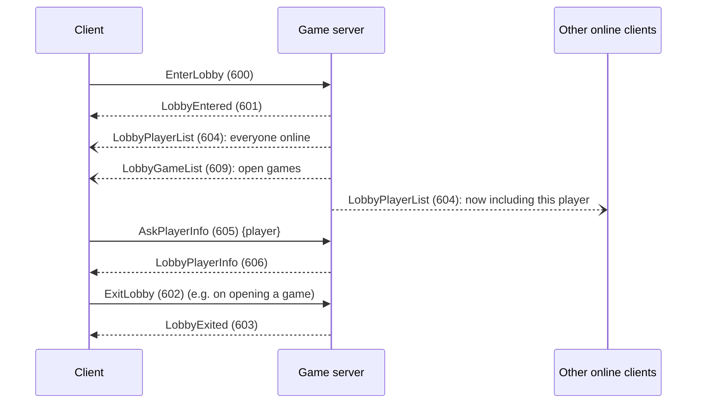
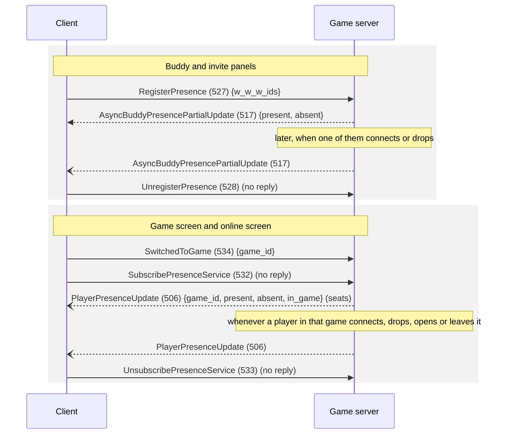
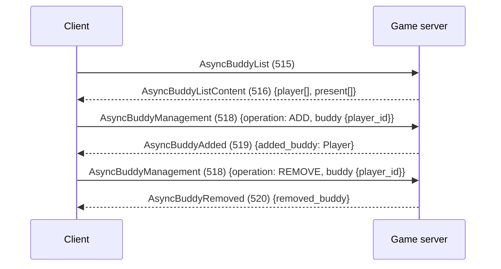
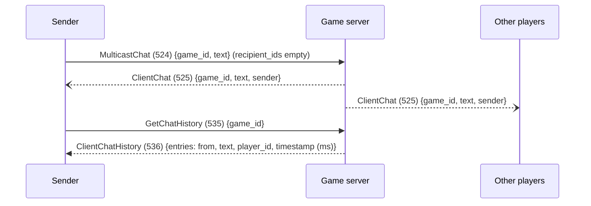
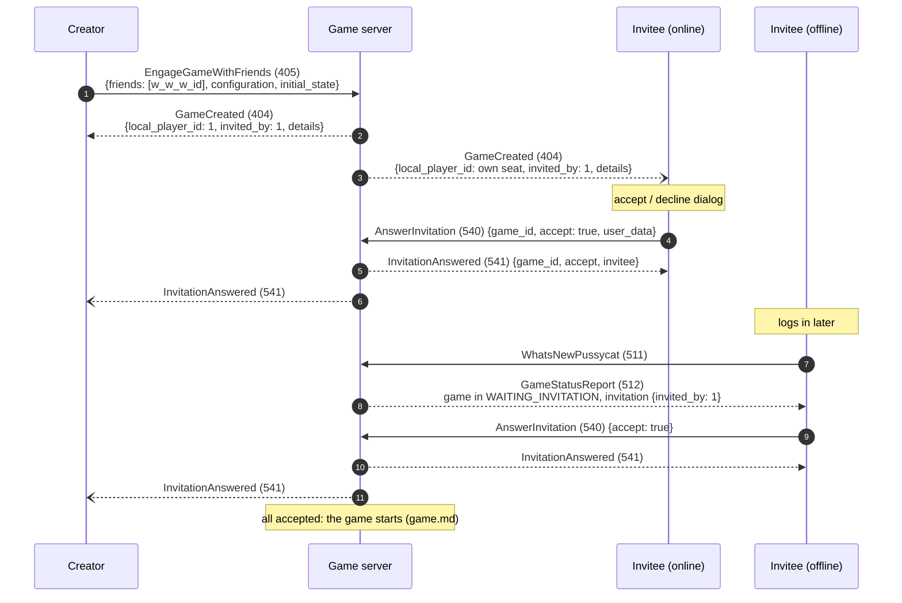
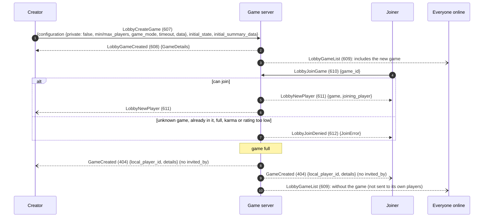
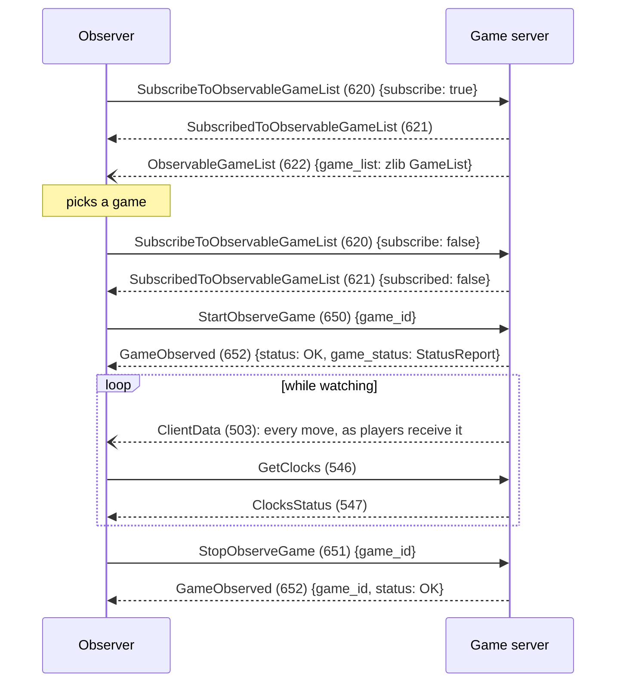

# Lobby, buddies, invitations and observing

All player ids in these messages follow the rule in the [overview](README.md#the-envelope): `Player.id` is a
position in the list being sent, and the account id is `w_w_w_id`.

## The lobby

- **`LobbyPlayerList` (604)** is the only way the lobby learns who is online. There are no add or remove messages:
  send the whole list (zlib-compressed `PlayerList`) to everyone whenever someone connects or drops.
- **`LobbyGameList` (609)** works the same way for open games (zlib-compressed `GameList` of `GameDetails`).
- **`AskAnyPlayerInfo` (630) → `PlayerInfo` (631)** looks up any player, online or not.

## Presence

The client shows each player as offline, online, or in this game. It asks for presence in two places.

`PlayerPresenceUpdate` lists **seat numbers**, not account ids. Account ids there crash the client once the game
screen is built. When the player to move drops from "in game" back to online or offline, the client shows "current
player absent".

## Buddies

- **Positions.** Each buddy's `Player.id` is its 1-based position in the list. A newly added buddy gets the next
  position.
- **Who can be invited.** The Buddies tab only offers an invite to players who own Ticket to Ride: those whose
  `Player.rights` contains a Days of Wonder product code for the base game:
  - `OLFT-TTOL-USAM-STEA` (Steam);
  - `-ALON` (standalone);
  - `-GOOG`, `-KNDL`, `-IPAD`, `-POCK`.

  The server builds them from each buddy's Asmodee `features`, as cached at that buddy's last login
  ([DESIGN.md](../DESIGN.md#entitlements)). It translates:
  - `tickettorideUSA_Steam` → `OLFT-TTOL-USAM-STEA`;
  - `_Standalone` → `-ALON`.

  The maps have codes too (`OLFT-TTOL-1910`, `-EURO`, `-SWIS`, `-ASIA`, `-INDI`, `-NORD`, `-PENN`, `-UKUK`, `-FRAN`,
  `-GERM`, ...), but they don't decide who can be invited. Without `rights`, nobody can be invited from that tab.
- **Offline buddies can be invited.** Async games don't need the invitee online (see Invitations below).
- **Changes go to the game server.** The client never tells Asmodee about buddy changes, so the server owns the list.

**Ignore list:** `AsyncIgnoreList` (560) → `AsyncIgnoreListContent` (561), and `AsyncIgnoreManagement` (562) →
`AsyncIgnoreAdded` (563) / `AsyncIgnoreRemoved` (564). Same shapes as buddies.

## Chat

- **Recipients.** An empty `recipient_ids` means everyone in the game, the sender included.
- **Lobby chat** has no `game_id`. Leave the field **absent** in `ClientChat` and `ClientChatHistory`: these are
  proto2 messages, and an explicit `game_id: 0` makes the client ignore the line.
- **Emotes** are ordinary text such as `<emoticon_7>`.
- **Blocked chat:** `ClientChatBlocked` (526) exists for that case.

## Invitations (friends games)

The Create Game screen's *Invitation* mode creates a game with chosen players.

- **Configuration.** `configuration` holds the name, `rated`, `lurkable`, `game_mode` (ASYNCHRONOUS), `timeout` (each
  player's time bank, in seconds; 2700 shows as "45 minutes"), `require_first_user_data_round` and `data` (with
  `pb.Settings`).
- **`initial_state`** is a `pb.T2RSummary`, not a game state. Don't send it back as `state`.
- **Seats, not account ids.** `local_player_id` and `invited_by` are seat numbers. The client shows the invitation
  dialog when they differ, so the creator gets `invited_by = local_player_id`.
- **Replying to the creator.** Without a reply to 405 the client gives up after about 30 seconds.
- **Offline invitees** get no push. The stored game shows up in their next status report.
- **A decline** aborts the game.
- **Refusing a game** (for example an unsupported map): reply `Error` (505) `{BAD_REQUEST}`. The client shows "Bad
  request" and recovers.

## Open games and automatch (lobby games)

The lobby's open games and the *Automatch* button both use lobby games. Automatch first searches the open-game list
and joins a match, and only creates a game when it finds none.

- **No `invited_by`.** `GameCreated` for a lobby game must not have `invited_by` set, or the waiting screen never
  starts the game.
- **Don't send its players the new list.** Players of the game that just started must not get the updated
  `LobbyGameList`. A list arriving right after `GameCreated` is handled instead of it, and the game never opens.
- **Leaving.** `LobbyLeaveGame` (613) → `LobbyPlayerLeftGame` (614), pushed to the game's other players. If the
  creator leaves, the game is dropped.
- **Lobby games are rated.** Karma and rating change only for lobby games, never for invitation games. `min_karma`
  and `min_rankscore` in the configuration let a creator restrict who can join (`NOT_ENOUGH_KARMA`,
  `NOT_ENOUGH_RANKSCORE`).

**Single-session games.** The Advanced tab's "absent player is immediately replaced by a robot" option creates a
lobby game with `game_mode: SYNCHRONOUS`. It starts the same way. For leaving and resuming, see
[game.md](game.md#leaving-a-single-session-game).

## Observing

Games created with `observable_by` set can be watched from the lobby's Observe tab.

- **The reply to `StopObserveGame` is required.** Without it every later request from that client stalls.
- **No cards.** Observers see the board from seat 1 with card counts but no cards. Whether `lurkable` games show
  hands is untested.
- **Untested:** how buddies-only observing is checked.
